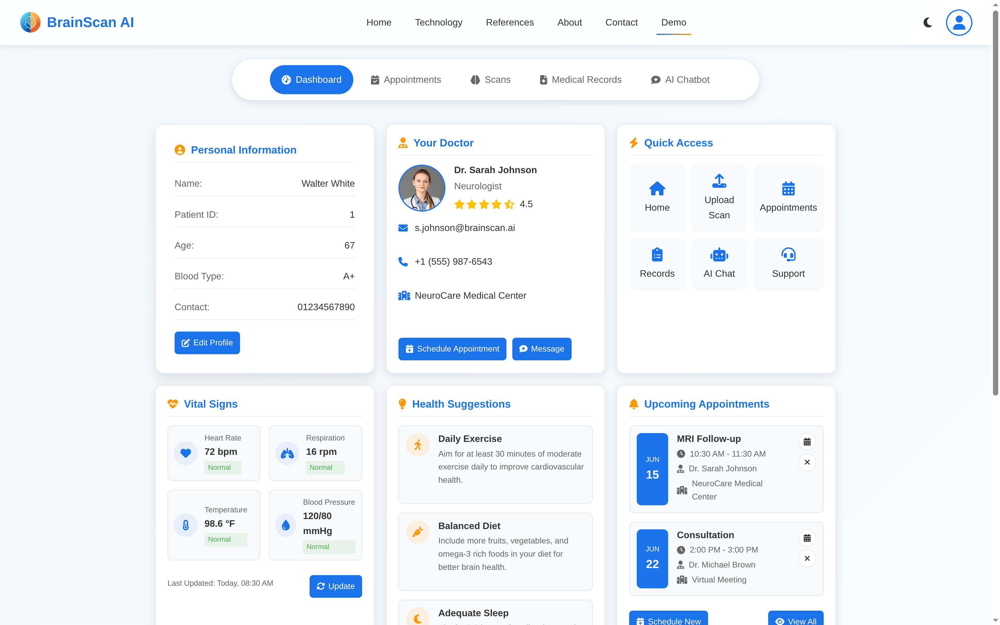
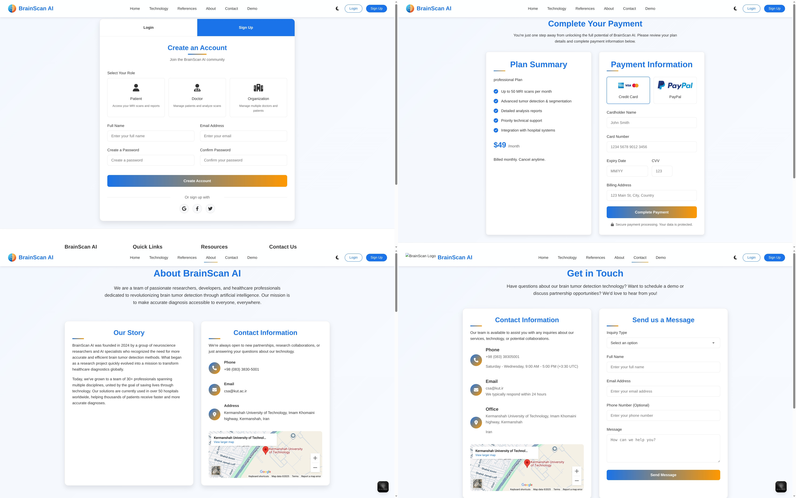

# Brain Tumor Detection Assistant 🧠🔬

A comprehensive medical assistant web application designed specifically for brain tumor patients, providing AI-powered brain scan analysis, patient management, and medical consultation tools.

## 🎯 Project Overview

This web application serves as a digital medical assistant for brain tumor patients, offering:

- **Patient Information Management**: Comprehensive patient profile and medical history tracking
- **Doctor Appointment Scheduling**: Integrated booking system for medical consultations  
- **AI-Powered Brain Scan Analysis**: Advanced tumor detection using custom YOLO models
- **Medical Records & History**: Complete diagnostic history and treatment tracking
- **AI Medical Chat Assistant**: Interactive consultation with MedGemma-powered chatbot

### 🤖 AI Technologies Used

- **YOLO (You Only Look Once)**: Custom-trained model for brain tumor detection and segmentation
- **MedGemma**: Medical language model for intelligent chat assistance and medical text generation

## 🧠 Pre-trained Model & Browser Demo

The custom `YOLO11m-seg` brain tumor segmentation model is published on Hugging Face together with its training results:

- **Model repository**: <https://huggingface.co/shahriarhd/brain-scan-ai-yolov11-seg>
- **Formats**: original `.pt`, `safetensors`, and `ONNX` (opset 12, 256×256 input)
- **Browser demo (GitHub Pages)**: <https://shahriar-hd.github.io/brain-scan-ai/>

The demo is a standalone page under [`docs/`](docs/) that runs the ONNX model **fully client-side** with ONNX Runtime Web — no server, no uploads. See [`docs/README`](docs/) and the model card for details. The conversion/upload scripts live in [`scripts/`](scripts/).

## 📸 Application Screenshots

### Main Dashboard

*Complete overview of patient dashboard with all core features*

### Application Pages

*Collection of key application pages including analysis, records, and chat features*

## 🌐 Website Pages

### 🏠 Main Pages
- **Home Page**: Website introduction and feature overview
- **Reference Page**: Developer and user documentation guide *(In Development)*
- **About Us**: Company information and mission statement
- **Contact**: Support and contact information
- **Login/Register**: User authentication and account creation
- **Payment**: Subscription and billing management

### 📱 Application Core (App Page)
The main application interface providing:
- **Patient Dashboard**: Personal medical information and overview
- **Appointment Booking**: Schedule consultations with medical professionals
- **Brain Scan Analysis**: Upload and analyze MRI/CT scans using AI
- **Medical Records**: Complete diagnostic history and reports
- **AI Chat Assistant**: Interactive medical consultation *(In Development)*

## 📁 Project Structure

```
brain-tumor-assistant/
├── app/                          # Main application directory
│   ├── templates/                # HTML template files
│   │   ├── index.html           # Home page
│   │   ├── app.html             # Main application interface
│   │   ├── login.html           # Authentication pages
│   │   ├── about.html           # About us page
│   │   └── ...                  # Other page templates
│   ├── static/                   # Static assets
│   │   ├── css/                 # Stylesheets
│   │   ├── js/                  # JavaScript files
│   │   ├── images/              # Website images and icons
│   │   └── fonts/               # Custom fonts
│   ├── models/                   # AI model files
│   │   ├── yolo11m-seg.pt       # Custom YOLO model
│   │   └── medgemma/            # MedGemma model files
│   ├── uploads/                  # User uploaded images
│   │   └── sample_scans/        # Test brain scan images
│   ├── app.py                    # Main Flask backend application
│   ├── requirements.txt          # Python dependencies
│   ├── train.ipynb              # Custom YOLO training notebook
│   └── power_measure.py          # Training power consumption monitor
├── screenshots/                  # Application screenshots
├── README.md                     # This file
└── LICENSE                       # Project license
```

## 🛠️ Installation & Setup

### System Requirements

**Minimum Hardware Requirements:**
- **RAM**: 16 GB minimum
- **GPU**: Graphics card with 4 GB VRAM minimum
- **Storage**: 10 GB free space
- **OS**: Windows 10/11, macOS 10.15+, or Linux Ubuntu 18.04+

**Software Requirements:**
- Python 3.8 or higher
- pip package manager
- Git

### Installation Steps

1. **Clone the repository**
   ```bash
   git clone https://github.com/shahriar-hd/brain-scan-ai.git
   cd brain-scan-ai/app
   ```

2. **Create virtual environment** (Recommended)
   ```bash
   python -m venv venv
   
   # Windows
   venv\Scripts\activate
   
   # macOS/Linux
   source venv/bin/activate
   ```

3. **Install dependencies**
   ```bash
   pip install -r requirements.txt
   ```

4. **Run the application**
   ```bash
   python app.py
   ```

5. **Access the application**
   Open your web browser and navigate to: `http://localhost:5000`
   Make sure that ollama rans a LLM model

## 🧪 Testing the Application

### Test Data
- Sample brain scan images are available in the `uploads/` directory
- These images have not been used during model training and serve as validation data
- Various scan types are included: normal scans and scans with different tumor types

### Test User Account
For testing purposes, use the following credentials:
- **Email**: `example@mail.com`
- **Password**: `8520`

### Testing Workflow
1. Log in using the test credentials
2. Navigate to the App page
3. Upload a sample brain scan from the `uploads/` directory
4. Review the AI analysis results
5. Check the generated reports and visualizations

## 🔧 Development

### Training Custom YOLO Model
The `train.ipynb` notebook contains the complete training pipeline for the custom brain tumor detection model. It includes:
- Data preprocessing and augmentation
- Model architecture configuration
- Training loop with validation
- Performance metrics and visualization

### Power Consumption Monitoring
Use `power_measure.py` to monitor system power consumption during training:
```bash
python power_measure.py
```

## 📊 Model Performance

The custom YOLO model has been trained specifically for brain tumor detection with:
- **Precision**: Optimized for medical accuracy
- **Segmentation**: Pixel-level tumor boundary detection
- **Multi-class Support**: Detection of various tumor types
- **Real-time Processing**: Fast inference for clinical use

## 🔒 Security & Privacy

- **Data Encryption**: All patient data is encrypted in transit and at rest
- **HIPAA Compliance**: Designed with medical privacy regulations in mind
- **Secure Authentication**: Multi-factor authentication support
- **Access Control**: Role-based permissions for different user types

## 🚀 Future Development

### Planned Features
- [ ] Complete AI chat assistant integration
- [ ] Advanced medical records management
- [ ] Multi-language support
- [ ] Mobile application
- [ ] Integration with hospital systems
- [ ] Telemedicine video consultations

### Technical Roadmap
- [ ] Model performance optimization
- [ ] Cloud deployment support
- [ ] API development for third-party integration
- [ ] Advanced analytics dashboard
- [ ] Real-time collaboration tools

## 🤝 Contributing

We welcome contributions to improve this medical assistant tool. Please:

1. Fork the repository
2. Create a feature branch (`git checkout -b feature/amazing-feature`)
3. Commit your changes (`git commit -m 'Add amazing feature'`)
4. Push to the branch (`git push origin feature/amazing-feature`)
5. Open a Pull Request

### Development Guidelines
- Follow PEP 8 coding standards
- Include comprehensive tests for new features
- Update documentation for any API changes
- Ensure medical accuracy in all AI-related features

## 📄 License

This project is licensed under the MIT License - see the [LICENSE](LICENSE) file for details.

## ⚠️ Medical Disclaimer

**Important**: This application is designed as a medical assistant tool and should not replace professional medical diagnosis or treatment. Always consult with qualified healthcare professionals for medical decisions.

## 📞 Support & Contact

- **Issues**: Please report bugs and feature requests through GitHub Issues
- **Documentation**: Comprehensive guides available in the Reference page
- **Email Support**: [shahriar.hd@outlook](mailto://shahriar.hd@outlook.com) - [amiritin123321@gmail.com](mailto://amiritin123321@gmail.com)
- **Medical Consultation**: This tool supplements but does not replace professional medical advice

## 🏥 Clinical Integration

This system is designed to integrate with existing medical workflows:
- **DICOM Support**: Compatible with standard medical imaging formats
- **HL7 Integration**: Healthcare data exchange capabilities
- **EMR Compatibility**: Works alongside electronic medical record systems
- **Audit Trails**: Complete logging for medical compliance

## 🌟 Acknowledgments

- Medical professionals who provided clinical guidance
- Open-source AI/ML community for foundational tools
- Ultralytics team for YOLO framework
- Google Research team for MedGemma model
- Beta testers and early adopters who provided valuable feedback

---

**Version**: 1.0.0  
**Last Updated**: August 2025  
**Maintained By**: Shahriar - Ramtin
